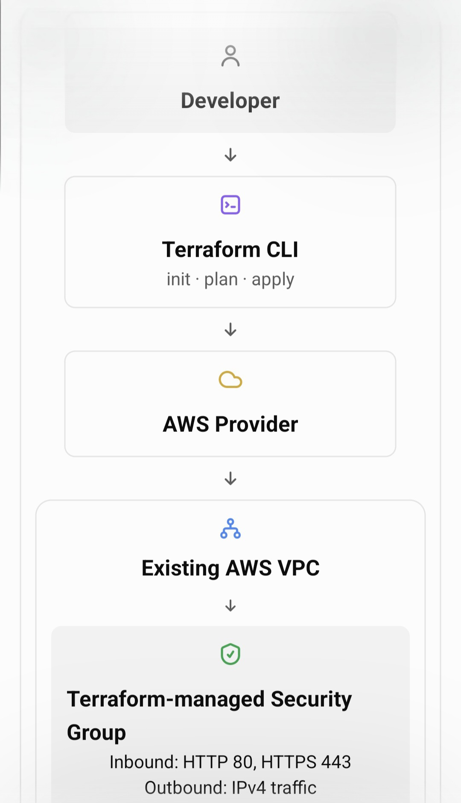

# Automating-AWS-Security-Group-Management-with-Terraform

Automating AWS Security Group Management with Terraform

📌 Project Overview

This project demonstrates how to automate the creation and management of AWS Security Groups using Terraform (Infrastructure as Code). It helps simplify firewall rule management, improve consistency, and support secure network access within AWS environments.

🎯 Objectives

- Automate AWS Security Group configuration using Terraform.
- Manage inbound and outbound traffic rules through code.
- Improve infrastructure consistency and maintainability.
- Apply secure network access practices.
- Simplify infrastructure updates using Terraform workflows.

🛠️ Technologies Used

- AWS – Cloud infrastructure
- Terraform – Infrastructure as Code (IaC)
- AWS VPC – Network isolation and security
- AWS Security Groups – Virtual firewall rules
- Git & GitHub – Version control and project documentation

## 🏗️ Architecture Diagram

The project uses Terraform to define and manage AWS Security Group rules within an AWS VPC.

## Security Group Rules

| Direction | Protocol | Port | Source/Destination |
|---|---|---|---|
| Inbound | TCP | 80 | 0.0.0.0/0 |
| Inbound | TCP | 443 | 0.0.0.0/0 |
| Outbound | All | All | 0.0.0.0/0 |

HTTP and HTTPS are public web ports. Restrict access further if your use case requires it.

⚙️ Implementation Steps

1. Configure AWS credentials with appropriate permissions.
2. Install Terraform and verify the installation.
3. Configure the AWS provider.
4. Define Security Group resources and required traffic rules.
5. Initialize Terraform using "terraform init".
6. Validate the configuration using "terraform validate".
7. Review planned changes using "terraform plan".
8. Apply the configuration using "terraform apply".
9. Verify the Security Group rules in the AWS Management Console.
10. Clean up resources when they are no longer required.

🔐 Security Considerations

- Follow the principle of least privilege.
- Restrict SSH access to trusted IP addresses.
- Allow only necessary inbound and outbound traffic.
- Avoid exposing credentials or sensitive information in GitHub.
- Review Terraform plans before applying changes.

📚 Key Learnings

- Infrastructure as Code with Terraform.
- AWS VPC and Security Group management.
- Terraform resource configuration and state management.
- Cloud networking and access control.
- Infrastructure automation and version control.

✅ Conclusion

This project demonstrates how Terraform can automate AWS Security Group management, making network configurations more consistent, maintainable, and easier to audit. It provides practical experience in AWS cloud security and Infrastructure as Code.

👩‍💻 Author

Pratiksha Pawar

